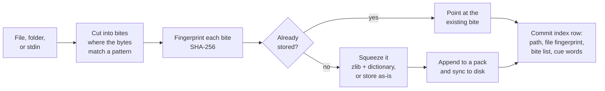
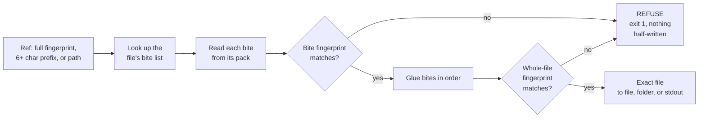
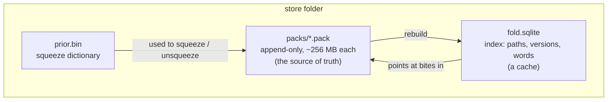
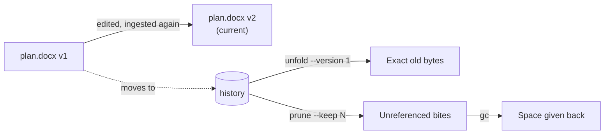
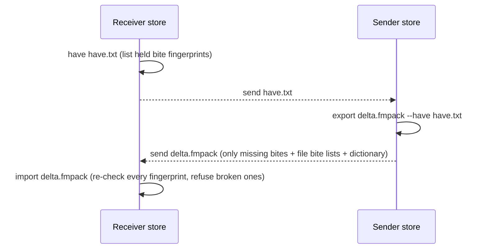

# asher.fold-memory 2.1.0

**Keep one copy. Give back the exact bits, or nothing.**

fold-memory stores the leftover copies of your files only once: the same log line written every minute, a backup of a backup, a spreadsheet emailed five times. It remembers every path each copy came from, and it hands a file back only if every fingerprint still matches.

- Python 3.8+, standard library only. No dependencies, no network, ever.
- Works as a CLI, as a Python library, or inside PostgreSQL (`add-to-postgres.sql`).
- An illustrated offline guide is in [`README.html`](README.html). The full plain-text guide is [`README FILE.txt`](README%20FILE.txt).

**Contents:** [The idea](#the-idea-in-one-minute) · [Quick start](#quick-start) · [Diagrams](#diagrams) · [Workflows](#workflows) · [Every capability](#every-capability-numbered) · [Command reference](#command-reference) · [Python](#use-it-from-python) · [What's new](#whats-new-in-21) · [Tested results](#tested-results) · [Limits](#honest-limits) · [Files](#files)

---

## The idea in one minute

Most storage bills are paid for copies. fold-memory cuts every file into bite-sized pieces, names each piece by its SHA-256 fingerprint, and keeps each distinct piece once. A second copy of a file costs a few bytes of bookkeeping. An edit near the start of a big file only creates new pieces around the edit.

| Measured | Result | What it means |
|---|---|---|
| Near-duplicate prose | **49.6% saved** | 50% is perfect. The prose never repeats, so this is real sharing, not compression tricks. |
| One edit in a 9 MB file | **~11–46 KB new** | The rest of the file still matched. |
| Unique random bytes | **0% saved** | The floor. A photo, an encrypted vault, or an original file stays its own size. |
| Network calls | **0** | It never reaches the network. |

Measured with `python fold_memory.py selftest`. Your numbers depend on how many copies your data really has. Run `sample` on a folder to find out without keeping anything.

---

## Quick start

```bash
python fold_memory.py selftest
```

```bash
python fold_memory.py ingest "/path/to/your/folder"
```

```bash
python fold_memory.py cue "leftover never deleted" --trance
```

```bash
python fold_memory.py unfold "/path/to/your/folder/report.pdf" --out restored/
```

```bash
python fold_memory.py stats
```

On Windows, use `py` if `python` isn't found. To install it as a `fold-memory` command, run this in the repo folder:

```bash
pip install .
```

**Where the store lives:** `--store <folder>` if given, else `$FOLD_MEMORY_STORE`, else `fold-memory-store/` next to `fold_memory.py`, else your data folder (`~/.local/share/fold-memory`, `~/Library/Application Support/fold-memory`, or `%LOCALAPPDATA%\fold-memory`).

---

## Diagrams

### 1. How storing works (`ingest`)



Text gets small bites (512 B–16 KB, about 2 KB on average) so edited lines resync quickly. Everything else gets bigger bites (8–256 KB, about 32 KB on average) to keep bookkeeping small. Already-compressed formats (jpg, png, mp4, zip, docx…) and bites that don't shrink are stored as they are.

**Why a crash loses at most a few seconds:** bites are written to the pack and synced first. Only then is the index row that points at them committed, every 2 seconds or 128 MB. If the power goes out in between, the pack holds bytes nobody points at yet, and `gc` takes them back later.

### 2. How getting back works (`unfold`, `restore`, `read()`)



stdout can't be taken back, so `unfold --out -` checks the whole file first. Files over 32 MB are spooled to a temp file inside the store, not held in memory.

### 3. What is on disk



Packs are plain append-only files, so they back up and sync well. The index, including version history, can always be rebuilt from them.

### 4. Versions (2.1)



History holds only replaced versions, so a folder that never changes costs nothing extra (about 8 KB on a 642-file test store). `prune` never drops the current version, or a version still current at another path.

### 5. Two machines over a slow or offline link



Measured: two small edits to a 9.8 MB log gave a 137 KB delta (the full store was 5.8 MB), rebuilt exactly on the other side.

---

## Workflows

### Workflow A: first run (prove it, then fold a folder)

1. **Check it on this machine.** 25 checks covering sharing, the floor, damage refusal, losing the index, and moving a delta.
   ```bash
   python fold_memory.py selftest
   ```
2. **See what you would save without keeping anything.**
   ```bash
   python fold_memory.py sample ~/Documents
   ```
3. **Fold it.** Unchanged files (same size and date) are skipped quickly on later runs.
   ```bash
   python fold_memory.py ingest ~/Documents --exclude "*.tmp"
   ```
4. **Check real sizes.** `disk_bytes` is the real disk, index included.
   ```bash
   python fold_memory.py stats
   ```

### Workflow B: find something and get it back

1. **Recall by words.** This searches names, folders, document text, photo camera and date, and song tags.
   ```bash
   python fold_memory.py cue "quarterly invoice acme"
   ```
2. **Widen recall** with word beginnings and partial matches.
   ```bash
   python fold_memory.py cue "invoic acm" --trance
   ```
3. **Get the exact file back, or a refusal.**
   ```bash
   python fold_memory.py unfold ~/Documents/invoice.pdf --out restored/
   ```
4. **Restore a whole folder** with layout, dates, and permissions. Preview it first.
   ```bash
   python fold_memory.py restore ~/Documents --out /mnt/recovered --dry-run
   ```
   ```bash
   python fold_memory.py restore ~/Documents --out /mnt/recovered
   ```

### Workflow C: undo a bad save

1. **List what was held at that path.**
   ```bash
   python fold_memory.py versions ~/Documents/plan.docx
   ```
2. **Take the older one back.**
   ```bash
   python fold_memory.py unfold ~/Documents/plan.docx --version 2 --out plan-before.docx
   ```

### Workflow D: clean up copies and free space

1. **List the copies worth deleting, biggest waste first.** They're already stored once, so this is what your source disks still pay for.
   ```bash
   python fold_memory.py dupes ~/Documents --limit 20
   ```
2. **Cap old versions.** Preview first.
   ```bash
   python fold_memory.py prune --keep 5 --dry-run
   ```
   ```bash
   python fold_memory.py prune --keep 5
   ```
3. **Give the space back.**
   ```bash
   python fold_memory.py gc
   ```

### Workflow E: nightly database dumps

1. **Pipe the dump in.** Only changed bites are new each night.
   ```bash
   pg_dump mydb | python fold_memory.py ingest - --name mydb-nightly.sql
   ```
2. **See every night held.**
   ```bash
   python fold_memory.py versions stdin/mydb-nightly.sql
   ```

Inside PostgreSQL 11+, run `add-to-postgres.sql` once (safe to re-run). It adds `fold_memory.fold_column(...)` and `restore_column(...)`, plus `get`, `verify`, `gc`, and `stats`. It refuses secret-shaped columns. A `pg_cron` example is at the bottom of the file.

```sql
select * from fold_memory.fold_column('public', 'app_logs', 'id', 'body',
    'created_at < now() - interval ''30 days''', true);
```

### Workflow F: when something breaks

1. **Check every bite.** This names the affected files.
   ```bash
   python fold_memory.py verify --full
   ```
2. **Index lost or damaged?** Rebuild it from the packs.
   ```bash
   python fold_memory.py rebuild
   ```
3. **Upgrading a 2.0 store?** Scrub and refresh the search index once. `stats` shows `reindex_recommended` when this is needed.
   ```bash
   python fold_memory.py reindex
   ```

---

## Every capability (numbered)

Numbered in the order a file moves through the tool. **(2.1)** marks what's new in this version.

### Storing

1. **Content-defined cutting.** Cut points come from the bytes themselves, so an insert only changes nearby bites. Text uses 512 B–16 KB bites, other data 8–256 KB. The cutting runs at C speed via the standard library.
2. **SHA-256 fingerprints.** Every bite and every whole file is named by its SHA-256. Change one bit and the name changes.
3. **One copy of each identical bite** across files, folders, nights, and machines. A bite seen twice in the same file is stored once too.
4. **Squeeze that knows when to stop.** zlib with a store dictionary by default. `--level fast|default|max` (max uses xz). `--codec zstd` on Python 3.14+. Already-compressed formats, and any bite that doesn't shrink, are stored as they are.
5. **Append-only pack files.** Bites live in a few big files (256 MB each by default, set with `FOLD_MEMORY_PACK_MB`), not millions of tiny ones.
6. **Every path remembered.** The same file at a second path costs only a location record. `ls` shows every path.
7. **Fast re-runs.** Files with the same size and modification time are skipped without reading. `--rehash` forces a re-read.
8. **Stdin ingest.** `ingest - --name nightly.sql` folds anything piped in, like database dumps.
9. **Parallel and concurrent.** `--jobs N` squeezes in parallel, and several ingests can write to one store at once.
10. **Crash safety.** Bytes are synced before the index points at them, with commits every 2 s or 128 MB. `kill -9` loses at most the last few seconds.
11. **Bounded memory.** Files of any size are streamed. A 768 MB file peaked at 58 MB of RAM (author's measurement, kept as a test).

### Getting back

12. **Exact unfold or refusal.** Every bite and the whole file are checked. A mismatch exits 1 and leaves nothing half-written. Output goes to a file, a folder, or stdout.
13. **Three ways to name a file:** a full fingerprint, a prefix of 6+ characters, or any path it was seen at.
14. **Folder restore.** `restore <prefix> --out dir` keeps the relative layout, modification dates, and permissions. `--dry-run` lists first. **(2.1)** Restoring from `/` keeps full paths and refuses rather than overwrite when two files would collide.
15. **Bounded-memory stdout (2.1).** Files over 32 MB are spooled to disk before being written to stdout, still fully checked first.
16. **Version history (2.1).** `versions <path>` lists every version held at a path, newest first, with dates. `unfold <path> --version N` brings one back.

### Recall

17. **Cue: search by words.** Ranked by where a word appears: file name (weight 8), fields such as title or subject (3), folder names (2), and body text (by frequency).
18. **Trance: wider recall.** `--trance` adds word-beginning matches, ranks partial matches, and boosts adjacent query words found together. It adds no storage.
19. **Reads inside files.** PDF text and info, Word/Excel/PowerPoint, ODF, EPUB, HTML titles, JSON, CSV headers, email headers and body, JPEG EXIF (camera, date), PNG/GIF/WebP size, MP3 ID3, MP4/MOV/HEIC boxes, WAV/FLAC/OGG tags, FITS headers, SQLite table names, and ZIP/TAR member names. Every reader is size-bounded, so a zip bomb can't blow up memory.
20. **Any language.** Chinese, Japanese, and Korean are split into character pairs. camelCase and digits are split into their parts.
21. **Secrets masked in search.** AWS, Google, GitHub, Stripe, OpenAI-style and Slack keys, JWTs, private-key headers, and `password=` / `token=` / `api_key=` text are replaced with `[masked]` before indexing. **(2.1)** This now covers metadata fields too (email subjects, CSV headers, document titles).
22. **Secret-shaped files skipped.** `.env`, `id_rsa`, `.pem`, `.key`, `.p12`, `.kdbx`, cookies, `wallet.dat`, `.netrc`, `credentials.json`, and similar are skipped unless you pass `--include-secret-names`. `.ssh`, `.gnupg`, and `.password-store` folders are never walked.

### Health

23. **Verify.** Reads and checks every bite and names the files it affects. `--full` also re-checks every whole file. A bite this Python can't decode (zstd on older Python) is reported as "not checked", never as damage.
24. **Rebuild.** Recreates the whole index, including version history, from the packs alone. It rolls back if it can't finish.
25. **Reindex (2.1).** Re-reads every held file from its own bites and rebuilds its words and preview, so a 2.0 index can be scrubbed without the original files.
26. **Honest stats.** `disk_bytes` is everything on disk (packs, index, and dictionary), shown alongside logical bytes, savings from copies, savings from squeezing, and old versions held.

### Space

27. **Forget.** Drop one path (with its old versions), a whole file by fingerprint, or a file at every path with `--everywhere`.
28. **Prune (2.1).** `prune --keep N [prefix]` keeps the newest N versions per path. The current version and anything still current elsewhere always stay. `--dry-run` shows the effect first.
29. **gc.** Frees bites nothing points at and repacks mostly-dead packs. It waits for other writers and leaves anything newer than 1 hour alone. `--dry-run`, `--deep`, and `--force` are available.
30. **Dupes (2.1).** Identical files at several paths right now, ranked by wasted bytes, with every path listed.
31. **Sample.** Estimates savings for a folder in a temporary store that is deleted afterwards.

### Moving and fitting in

32. **Delta sync between machines.** `have` → `export --have` → `import` moves only missing bites, and every fingerprint is re-checked on arrival. **(2.1)** The squeeze dictionary travels too, so stores with different dictionaries can trade.
33. **Python library.** `FoldMemory(store)` with `ingest_file`, `ingest_bytes`, `ingest_stream`, `ingest_tree`, `cue`, `read`, `unfold`, `restore`, `versions`, `prune`, `dupes`, `verify`, and `stats`. Failures raise `Refused`.
34. **Inside PostgreSQL (11+).** `add-to-postgres.sql` adds `fold_column` / `restore_column` to fold old column values into one box per unique value, plus `get`, `verify`, `gc`, and `stats`. It refuses secret-shaped columns. A `pg_cron` example is included.
35. **Self-upgrading stores.** A 1.0 store upgrades the first time 2.x opens it. A 2.0 store gets its history back from its packs when 2.1 opens it. 2.0 can still read stores and exports written by 2.1.
36. **Safe walking.** Pipes, devices, and sockets are skipped (it never hangs). Symlink loops are detected with `--follow-links`. OneDrive/iCloud placeholders are skipped unless `--hydrate-cloud`. Names that aren't valid UTF-8 are kept exactly.
37. **Runs anywhere, offline.** Windows, Mac, Linux, Raspberry Pi, NAS, Android (Termux), iOS (a-Shell / Pythonista), and air-gapped servers.
38. **Selftest.** 25 checks you can run on your own machine, reporting measured numbers, not claims.

---

## Command reference

Every command takes `--store <folder>`, and every result is printed as JSON, so it can be scripted.

| Command | What it does | Exit |
|---|---|---|
| `ingest <paths…\|->` | Fold files, folders, or stdin. Options: `--exclude`, `--level`, `--codec`, `--jobs`, `--rehash`, `--follow-links`, `-v` | 0 |
| `cue "words" [--trance]` | Recall by words | 0 |
| `unfold <ref> [--out f\|dir/\|-] [--version N]` | Exact file back, or refuse. With no `--out`, verify only | 0 / 1 |
| `restore <prefix> --out dir [--dry-run]` | A whole folder back | 0 / 1 |
| `versions <path>` *(2.1)* | Every version held at a path | 0 / 1 |
| `ls [prefix]` | Remembered paths | 0 |
| `dupes [prefix] [--limit N]` *(2.1)* | Copies at several paths, biggest waste first | 0 |
| `stats` | Honest sizes | 0 |
| `verify [--full]` | Check every bite (and every whole file) | 0 / 1 |
| `forget <ref…> [--everywhere]` | Drop a path or a file | 0 / 1 |
| `prune --keep N [prefix] [--dry-run]` *(2.1)* | Cap old versions per path | 0 / 2 |
| `gc [--dry-run] [--deep] [--force]` | Give space back | 0 / 1 |
| `rebuild` | Index from packs | 0 / 1 |
| `reindex` *(2.1)* | Words and previews from the held bytes | 0 / 1 |
| `have [file]` · `export out [refs] [--have f]` · `import pack` | Move only missing bites between stores | 0 / 1 |
| `sample <paths>` | Estimate savings, keeping nothing | 0 |
| `selftest` · `smoke` | Prove it here · open the store and exit | 0 / 1 |

---

## Use it from Python

```python
from fold_memory import FoldMemory

with FoldMemory("/data/closet") as fm:
    fm.ingest_file("report.pdf")
    fm.ingest_bytes(b"...", "name.bin")
    hits = fm.cue("quarterly report")
    data = fm.read(hits[0]["file_sha"])   # exact bytes, or raises Refused
```

---

## What's new in 2.1

**Fixes (each has a regression test that fails on 2.0):**
- Secrets in metadata fields (email subjects, CSV headers, titles) are now masked before indexing. For existing stores, run `reindex` once.
- Export/import now works between stores with different compression dictionaries.
- `restore` with an empty prefix keeps the full layout and refuses rather than overwrite on path collisions.
- `unfold --out -` spools files over 32 MB to disk instead of holding them in RAM.

**New:** `versions`, `unfold --version`, `prune`, `dupes`, `reindex`.

See `README FILE.txt` for the full changelog, including what was fixed from 1.0 to 2.0.

---

## Tested results

| | 1.0 | 2.0 |
|---|---|---|
| Said it saved | 63% | 56% |
| Real disk saved | 45% (63.4 MB) | 56% (50.3 MB) |
| Paths remembered | 627 | 1,281 |
| Time | 13.0 s | 4.9 s |

*Test pile: 114.6 MB, made of a Python source tree, its backup copy, and 30 MB of random bytes. Author's measurements.* See [`TESTED RESULTS GRAPHS.svg`](TESTED%20RESULTS%20GRAPHS.svg).

Run the tests:

```bash
python -m unittest discover -s tests
```

The suite has 44 tests (29 from 2.0, plus 15 in `tests/test_v21.py`). The author ran 2.1 on Python 3.8 and 3.13, and the zstd test needs Python 3.14. On upload to this repo, `selftest` (25/25) and `tests/test_v21.py` (15/15) were re-run on Linux and passed.

---

## Honest limits

- **Unique data doesn't shrink.** Savings track how many copies you have, not how much data you have. For unique photos, rows, or encrypted disks, plan on about 0–10%. Run `sample` before promising anyone a number.
- **No encryption.** The store is as private as its disk, so use disk encryption for private files. Secret masking protects the search index, not the stored bytes. Don't point it at password stores.
- **A smaller cloud bill may not follow.** PostgreSQL keeps a table's file the same size after a delete until `VACUUM FULL` or a repack runs, and providers bill the disk you rented.
- No direct S3/blob backend. Run it on the machine that has the disk.
- Don't put the store on a network share (SMB/NFS) with multiple writers. Use export/import instead.
- Stores made with `--codec zstd` need Python 3.14+ to read.
- The index costs about 10 KB per unique file.
- The PostgreSQL file is unchanged from 2.0 and was not re-run for 2.1.

---

## Files

| File | Purpose |
|---|---|
| `fold_memory.py` | The runner and Python library |
| `add-to-postgres.sql` | Store inside PostgreSQL, with working functions |
| `pyproject.toml` | `pip install .` provides the `fold-memory` command |
| `README.html` | Illustrated offline guide |
| `README FILE.txt` | Full plain-text guide, changelog, device notes, and cost estimates |
| `TESTED RESULTS GRAPHS.svg` / `.html` | Measured results, drawn |
| `tests/` | Python tests, Postgres test, and the 1.0 runner kept for upgrade tests |

## License

All rights reserved by the author unless they say otherwise.

*Copies die, uniqueness stays.*
